<!-- ═══════════════════════════════════════════════════════════════════ -->
<!--               A B U   Z A R   M I S H W A N I                      -->
<!--               SYSTEM: J.A.R.V.I.S. // PROTOCOL E.D.I.T.H.          -->
<!-- ═══════════════════════════════════════════════════════════════════ -->

<div align="center">



</div>

<br />

```yaml
┌── SYSTEM :: J.A.R.V.I.S. / E.D.I.T.H. NEURAL CORE ──────────────────────────────┐
│                                                                                  │
│  DOMAIN       ::  Software Architecture × Artificial Intelligence & ML           │
│  SPECIALTY    ::  Autonomous Agents · Neural Synthesis · Scalable Infrastructure │
│  DIRECTIVE    ::  "Engineering autonomous intelligence to amplify human agency." │
│  STATUS       ::  OPTIMAL // CONTINUOUS INFERENCE & SYNTHESIS                    │
│                                                                                  │
└──────────────────────────────────────────────────────────────────────────────────┘
```

<br />

### `◈` Neural Architecture & Intelligence Vectors

```
[01] AUTONOMOUS AGENTS & COGNITIVE SWARMS
     ├─ Multi-Agent Consensus, Planning Loops & Dynamic Tool Synthesis
     ├─ Self-Correcting Execution & Context Window Optimization
     └─ Goal-Directed Autonomous Workflow Orchestration

[02] MACHINE LEARNING & NEURAL FOUNDATIONS
     ├─ Foundation Models, Fine-Tuning & Synthetic Data Generation
     ├─ High-Dimensional Embeddings & Hybrid Semantic Retrieval (RAG)
     └─ Real-Time Multimodal Inference & Evaluation Harnesses

[03] HIGH-PERFORMANCE PRODUCTION RUNTIMES
     ├─ Distributed Low-Latency Systems & Microservices
     ├─ Kernel-Level Mobile & Device Architecture (DPC / MDM)
     └─ Mission-Critical Fault Tolerance & Scalability
```

<br />

<div align="center">

<!-- Futuristic HUD Separator -->


<br />

> *"Sometimes you gotta run before you can walk."*  
> `// PROTOCOL: E.D.I.T.H. — Even Dead, I'm The Hero.`

</div>
